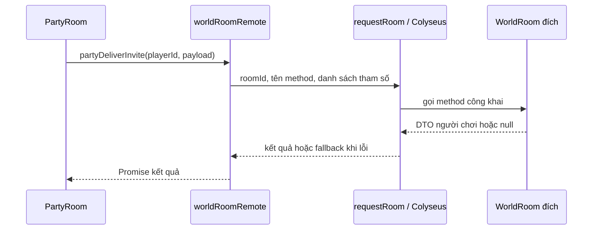

# Tương tác giữa các room

## 1. Nguyên tắc và trách nhiệm

Mỗi room sở hữu state và quy tắc của mình. Room khác gửi yêu cầu qua RPC remote,
không lấy instance của room đích để đọc hoặc sửa state trực tiếp.

| Thành phần              | Trách nhiệm                                                                      |
| ----------------------- | -------------------------------------------------------------------------------- |
| `WorldRoom`             | Người chơi trong map, chiến đấu, áp dụng phần thưởng, lưu dữ liệu và chuyển map  |
| `PartyRoom`             | Thành viên, trưởng nhóm, chế độ loot và phân bổ phần thưởng                      |
| Room `dungeon`          | Instance dungeon, hiện dùng lại class `WorldRoom`; định tuyến theo `instanceId`  |
| Command / service world | Command xử lý hành động và gọi RPC; service giữ xử lý dùng lại và capability RPC |
| Coordinator             | Điều phối quy trình cần nhiều room, ví dụ đưa cả party vào dungeon               |
| Directory               | Tra cứu `playerId` đang thuộc party nào, đang ở world room nào                   |

Toàn bộ logic runtime và DTO party nằm trong `src/rooms/party`. World chỉ dùng
entrypoint công khai `party.shared.ts` (DTO, enum, hàm thuần và directory) hoặc
`party.remote.ts` (RPC), không import trực tiếp implementation bên trong party.
Mỗi file `<room>.remote.ts` dùng `import type` từ class room tương ứng để suy ra
chữ ký method. Không cần interface Contract khai báo lại các method.

Riêng `party_config` được lưu trong master data, nên schema Zod và enum loot-mode
nằm trong `src/modules/master-data`. Module master-data không phụ thuộc room.

Directory là thông tin định tuyến có thời hạn, có thể cũ khi người chơi đổi map.
Room sở hữu dữ liệu vẫn phải kiểm tra người chơi và trạng thái thực tế khi nhận RPC.

## 2. Các file cần biết

World có entrypoint tương ứng là `src/rooms/world/world.shared.ts`: xuất enum/DTO
message, `WorldRoomOptions` và `buildClientSkillConfig`. Phần export cấu hình client
đang dùng hàm builder qua entrypoint này. Message được khai báo trong
`world/types/world-message.type.ts`, options trong `world/types/world-room.type.ts`.
Không export `WorldRoom`, state sống hoặc service runtime qua file shared.

Các đường dẫn dưới đây tính từ thư mục gốc project.

| File                                                                     | Vai trò                                                              |
| ------------------------------------------------------------------------ | -------------------------------------------------------------------- |
| `src/rooms/party/types/party-room.type.ts`                               | DTO dùng chung cho yêu cầu và kết quả RPC                            |
| `src/rooms/party/party.remote.ts`, `src/rooms/world/world.remote.ts`     | Remote có kiểu và fallback cho từng method                           |
| `src/rooms/party/party.shared.ts`                                        | Entry point DTO, enum, hàm thuần và directory cho room khác          |
| `src/core/rooms/room.integration.ts`                                     | Kiểu RPC dùng chung, gọi Colyseus, timeout, log và fallback          |
| `src/rooms/world/modules/players/services/player-party.world.service.ts` | Capability RPC, tìm player, tạo/áp dụng snapshot và xử lý dùng chung |
| `src/rooms/coordinators/dungeon-party.coordinator.ts`                    | Kiểm tra các thành viên và điều phối vào dungeon                     |
| `src/rooms/party/services/party-directory.service.ts`                    | Tra cứu vị trí world, party và thông tin nhóm dự kiến vào dungeon    |

## 3. Một lời gọi đi như thế nào?

Command gọi trực tiếp `partyRoomRemote`/`worldRoomRemote` khi xử lý một hành động.
Không có lớp `world-party.integration.ts` trung gian. Phía world phân chia như sau:

| Xử lý                                                         | Nơi sở hữu                                                     |
| ------------------------------------------------------------- | -------------------------------------------------------------- |
| Gắn world với party khi vào map                               | `PartyAttachWorldCommand`                                      |
| Tách world hoặc rời party khi ra khỏi map                     | `PartyDetachWorldCommand`                                      |
| Làm mới vị trí người chơi trong directory                     | `PartyHeartbeatWorldCommand`                                   |
| Báo HP/level/map sang party                                   | `PartyReportWorldCommand`                                      |
| Xin gia nhập, từ chối lời mời                                 | `PartyRequestJoinWorldCommand`, `PartyDeclineWorldCommand`     |
| Tạo/lấy party để tạo nhóm hoặc vào dungeon                    | `playerPartyWorldService.ensureParty()` vì được nhiều nơi dùng |
| Tìm player, tạo/áp dụng snapshot, nhận RPC membership/lời mời | `playerPartyWorldService`                                      |

Các command trên nằm trong `world/modules/players/commands`, service nằm trong
`world/modules/players/services`. Lifecycle và timer của world dispatch command
tương ứng. Coordinator giữ quy trình phối hợp party và world như vào dungeon.

Tìm/tạo party thuộc `playerPartyWorldService.ensureParty()` phía world vì luồng này
chỉ gọi `partyRoomRemote`. Nếu đã có party, service xác nhận thành viên qua RPC.
Nếu cần tạo mới, service gọi matchmaking vì chưa có room đích để gọi remote.
Các yêu cầu tạo đồng thời cho cùng player dùng chung Promise trong một process.
`isPartyRoomListed()` chỉ kiểm tra listing matchmaking, không bảo đảm room còn phản hồi RPC.



Ví dụ đang dùng trong lệnh mời party:

```ts
import { worldRoomRemote } from "@/rooms/world/world.remote.js";

const snapshot = await worldRoomRemote(worldRoomId).partyDeliverInvite(target.id, {
    partyRoomId: context.room.roomId,
    fromName: context.nameOf(leaderId),
    expiresInSec: 30,
});

if (!snapshot) {
    // Không nhận được snapshot: có thể player đã rời room hoặc RPC bị lỗi.
    return;
}
```

`context`, `target`, `leaderId` trong ví dụ là dữ liệu của command đang xử lý.
`worldRoomId` là ID instance room đích, không phải tên đăng ký `"world"`.

Hàm `partyDeliverInvite` trong `world.remote.ts` gọi `matchMaker.remoteRoomCall()` với
tên method tương ứng. Code nghiệp vụ không cần viết chuỗi tên method hoặc
truyền mảng tham số thủ công. TypeScript kiểm tra tên method, thứ tự và kiểu tham số
theo method thực tế trên class room. Mọi lời gọi qua remote đều trả `Promise`, kể cả method đích chạy đồng bộ.

Remote không tạo kết nối WebSocket mới và không yêu cầu client Unity join room đích.
Đây là giao tiếp nội bộ giữa các room trên server.

## 4. Cách sử dụng

### World gọi party

```ts
import { partyRoomRemote } from "@/rooms/party/party.remote.js";

const party = partyRoomRemote(partyRoomId);
const snapshot = await party.attachWorld(player.id, room.roomId, memberInfo);

if (snapshot) {
    player.partyRoomId = snapshot.partyRoomId;
    player.partyLootMode = snapshot.lootMode;
}
```

`memberInfo` là DTO `PartyMemberInfo`, được tạo từ state của world. Không truyền
`PlayerWorldState`, `Room`, `Client`, `MapSchema`, function hoặc instance service qua RPC.
Dùng object/array và các giá trị có thể biểu diễn bằng JSON; khi cần danh sách từ
`Map`, chuyển thành array trước. Không dựa vào prototype hoặc tham chiếu object được giữ nguyên.

### Quy trình cần nhiều room

Đặt việc điều phối vào coordinator thay vì để world và party gọi vòng qua lại.
Quy trình dungeon hiện tại:

1. Party trả kế hoạch và danh sách thành viên qua `prepareDungeon()`.
2. Coordinator gọi `partyCheckDungeon()` trên world của từng thành viên.
3. Nếu các kiểm tra đều đạt, tạo một `instanceId` chung và ghi danh sách dự kiến.
4. Gọi `partyEnterDungeon()` cho các thành viên.
5. Nếu có lỗi, báo lại party bằng `notifyDungeonDenied()`.

Đây chưa phải giao dịch chuyển room nguyên tử: một người có thể đã chuyển trong khi
người khác lỗi. Nếu mở rộng quy trình này, cần bổ sung mã thao tác và đối soát trạng thái;
không mặc định rằng timeout đồng nghĩa với chưa chuyển room.

## 5. Thêm một tương tác mới

Ví dụ muốn world đọc thông tin tổng quan của party. Đây là ví dụ mở rộng,
`getSummary()` chưa tồn tại trong code hiện tại.

### Bước 1: Khai báo DTO dùng chung

Thêm vào `src/rooms/party/types/party-room.type.ts`:

```ts
export interface PartySummary {
    partyRoomId: string;
    leaderPlayerId: string;
    memberCount: number;
}
```

Module chỉ mô tả dữ liệu trao đổi, không import implementation của room.
Nếu thao tác có thể bị từ chối vì nghiệp vụ, khai báo kết quả rõ ràng, ví dụ
`{ ok: true; ... } | { ok: false; reason: ... }`.

### Bước 2: Cài đặt ở room sở hữu dữ liệu

Ví dụ thêm capability vào `PartyRoom`, với type `PartySummary` import từ file DTO:

```ts
getSummary(): PartySummary | null {
    if (this.disbanded) return null;
    return {
        partyRoomId: this.roomId,
        leaderPlayerId: this.state.leaderPlayerId,
        memberCount: this.state.size,
    };
}
```

Remote suy ra kiểu từ `PartyRoom`, nên method RPC phải là method công khai của room đích.
Nếu logic dài, tách thành service riêng và để method trên room gọi service đó. Không cần thêm interface Contract.

### Bước 3: Khai báo hàm trong remote

Trong `party.remote.ts`, thêm tên method vào `PartyRpc` (danh sách `Pick<PartyRoom, ...>`) và một dòng vào `partyRoomRemote`:

```ts
getSummary: (...args) => call(roomId, "getSummary", args, null),
```

Tham số thứ tư của `call` là fallback khi timeout hoặc room không còn (bỏ trống = `undefined`).
Kiểu tham số/kết quả suy ra từ `PartyRoom`, nên đổi chữ ký method trên room thì typecheck báo lỗi.
`PartyRemote` là mapped type theo `keyof PartyRpc`, nên click vào tên ở chỗ gọi sẽ nhảy thẳng tới method trên room.

### Bước 4: Gọi từ nơi cần dùng

```ts
const summary = await partyRoomRemote(partyRoomId).getSummary();
if (!summary) return;
// Dùng summary.memberCount, summary.leaderPlayerId...
```

Nếu cần phân biệt rõ “party không tồn tại” với “không gọi được room”, thiết kế kết quả
nghiệp vụ thành DTO riêng và dùng `undefined` làm fallback. Kiểm tra tường minh theo
thiết kế đó; không dùng chung một giá trị cho cả hai tình huống rồi suy luận nguyên nhân.

### Bước 5: Kiểm tra

Kiểm tra luồng thành công, room không còn/player đã đổi room, từ chối nghiệp vụ,
timeout và xử lý lặp nếu có mutation. Kiểm tra type để bắt tên method hoặc tham số sai.
Chạy `yarn typecheck` và `yarn lint`.

## 6. Command và service đặt ở đâu?

- Hành động từ client hoặc lifecycle của room được xử lý bởi command, mỗi class một file.
- Logic chỉ phục vụ một hành động nằm trong command đó; không tạo service để bọc nguyên handler.
- Xử lý tái sử dụng hoặc capability được nơi khác gọi, như truy vấn RPC trả snapshot,
  có thể nằm trong service. Method công khai trên room là điểm vào của RPC, và nên chỉ dispatch command.
- Method RPC trên room cũng chạy trong command. Command cần trả dữ liệu thì khai báo field
  `result`, gán trong `execute()` (vẫn trả `void`), và room đọc lại bằng
  `dispatchForResult(...)`. Không trả DTO từ `Command.execute()`: dispatcher coi giá trị
  trả về là command con.

Chi tiết: [Quy tắc command](room-command-pattern.md).

## 7. Timeout, fallback và xử lý lặp

`requestRoom()` giới hạn chờ 3 giây, đồng thời truyền cùng giới hạn cho Colyseus IPC.
Khi có lỗi, hàm ghi log và trả fallback của method. Giá trị trả về hiện không chứa
metadata cho biết đó là kết quả thật hay fallback.

Ví dụ `partySetPlayerParty()` thành công trả `undefined`, fallback cũng là `undefined`.
Vì vậy `await` lời gọi này chưa chứng minh cập nhật đã được áp dụng. Khi cần xác nhận,
thiết kế DTO xác nhận hoặc cơ chế đồng bộ lại trạng thái.

Timeout dừng chờ ở bên gọi, không hủy công việc ở room đích. Không tự động retry mọi
mutation. Với cộng thưởng, trừ tiền, tạo instance hoặc chuyển map, dùng `eventId`/
`operationId` và lưu kết quả đã xử lý để cùng mã thao tác không gây tác động lần hai.
Cần cân nhắc thời hạn lưu kết quả và trường hợp room/process khởi động lại.

Hiện tại phân bổ loot có chống lặp bằng `eventId` với cache giới hạn trong bộ nhớ của
party room. Membership dùng revision theo nguồn party; báo cáo world dùng revision
theo nguồn world để bỏ cập nhật cũ. Đây không phải bảo đảm mọi RPC đều chống lặp
hoặc mọi lời gọi top-level đều chạy tuần tự; kiểm tra lại điều kiện sau các `await`
khi trạng thái có thể thay đổi.

## 8. Thêm loại room mới, ví dụ chat

Khi cần vòng đời và state riêng, tạo room mới cùng DTO và remote riêng:

1. Khai báo DTO trong `src/rooms/chat/types/` nếu chat là tính năng runtime của room.
2. Tạo `ChatRoom` cùng cấu trúc commands/modules/schemas và các method RPC công khai.
3. Đăng ký room tại `src/rooms/index.room.ts` và cung cấp class từ entrypoint.
4. Tạo `src/rooms/chat/chat.remote.ts`, import type `ChatRoom` và khai báo `chatRoomRemote` theo mẫu của `partyRoomRemote` (mỗi RPC một hàm gọi `requestRoom`). Nếu cần chia sẻ DTO/hàm thuần, xuất qua `chat.shared.ts`.
5. Xác định cách tra cứu instance chat đích, ví dụ theo server/shard; không dùng tên
   đăng ký room thay cho `roomId` khi gọi RPC.
6. Đặt quy trình cần nhiều room vào coordinator và bổ sung test ranh giới import.

Các bước trên là hướng mở rộng, chat chưa được cài đặt. Có thể dùng kênh logic trong
chat room cho local/party/private; room đích kiểm tra người nhận và quyền gửi từ
trạng thái server. System/alert có thể là loại thông điệp, không bắt buộc mỗi loại
là một room riêng.

## 9. Chạy nhiều process

`src/configs/redis.config.ts` bật cả `RedisDriver` và `RedisPresence` khi có `REDIS_URI`,
đồng thời cấu hình cache dùng Redis. Các process cần dùng chung cấu hình Redis để
tra cứu room, gửi RPC và chia sẻ directory. Không cấu hình Redis thì chỉ dùng cho
một process với dữ liệu trong bộ nhớ.

RPC phù hợp khi biết room đích và cần kết quả. Nếu sau này cần phát sự kiện cho nhiều
room mà không cần kết quả từng room, có thể thiết kế pub/sub qua Presence; cần tự
quản lý subscribe/unsubscribe và quy tắc xử lý sự kiện. Các lời gọi party/world mô tả
ở tài liệu này hiện dùng RPC.

Việc typecheck và test trong một process không thay thế kiểm thử thực tế giữa hai
process dùng Redis. Khi triển khai nhiều process, kiểm tra thêm gọi chéo process,
room bị dispose, timeout và thay đổi vị trí người chơi.
