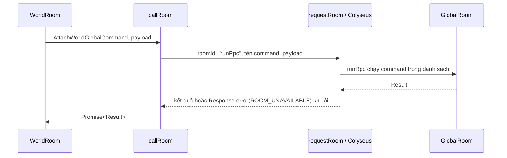

# Tương tác giữa các room

## 1. Nguyên tắc và trách nhiệm

Server chỉ có **hai room**; mỗi player giữ hai kết nối (world + global), đều gắn với một `serverId`
(`options.serverId` bắt buộc và phải khớp token, kiểm trong `AuthenticatedPlayerRoom.onAuth`).
Mỗi room sở hữu state và quy tắc của mình. Room khác gửi yêu cầu qua RPC remote,
không lấy instance của room đích để đọc hoặc sửa state trực tiếp.

| Thành phần              | Trách nhiệm                                                                                                          |
| ----------------------- | -------------------------------------------------------------------------------------------------------------------- |
| `WorldRoom` (`world`)   | Người chơi trong map, chiến đấu, áp dụng phần thưởng, lưu dữ liệu và chuyển map; `filterBy(["serverId","mapCode"])`  |
| `WorldRoom` (`dungeon`) | **Cùng class `WorldRoom`**, đăng ký lần hai với `filterBy(["serverId","instanceId"])`: mỗi lượt dungeon một instance |
| `GlobalRoom`            | Một room / `serverId`: chat, party (thành viên, chủ, chế độ loot, phân bổ thưởng), presence, điều phối vào dungeon   |
| Command / service       | Command xử lý hành động và gọi RPC; service giữ xử lý dùng lại và capability RPC                                     |

`dungeon` là lựa chọn có chủ đích: một biến thể đăng ký (instance riêng) của `WorldRoom`, **không** phải room thứ ba.
Hai tên đăng ký dùng chung state, bộ message và code; chỉ khác bộ lọc matchmaking.

Party không còn là room riêng: logic và DTO nằm trong `src/rooms/global/modules/party` (`PartiesState`:
`partyId → PartyState`). Chat nằm ở `global/modules/chat`, presence (player đang ở world room nào) ở
`global/modules/world-registry` (field presence của `PlayerDataState`), điều phối vào dungeon ở `global/modules/dungeon-launch`. Chat↔party↔presence là gọi service cùng room,
không còn RPC. Mở rộng sau này (friend, guild, mail...) là module mới trong `global`.

World chỉ dùng entrypoint công khai `global.shared.ts` (DTO, enum, hàm thuần) hoặc các **command RPC** của global
(để gọi bằng `callRoom`), không import service, schema hay implementation khác bên trong global; ngược lại global chỉ import
`world.shared.ts` và **command RPC** của world (import trực tiếp class command để `callRoom` suy kiểu). Kiểu payload và kết quả suy ra từ chính class command, không cần interface Contract.

Riêng `party_config` và `chat_config` được lưu trong master data nên schema Zod và enum liên quan nằm trong
`src/modules/master-data`, không phụ thuộc room.

Presence là thông tin định tuyến có thời hạn, có thể cũ khi người chơi đổi map. Room sở hữu dữ liệu vẫn phải kiểm tra
người chơi và trạng thái thực tế khi nhận RPC.

## 2. Các file cần biết

World có entrypoint `src/rooms/world/world.shared.ts` (enum/DTO message, `WorldRoomOptions`, `buildClientSkillConfig`);
global có `src/rooms/global/global.shared.ts`. Không export `WorldRoom` / `GlobalRoom`, state sống hay service runtime
qua file shared. Message khai báo trong `<room>/types/<room>-message.type.ts`, options trong `<room>/types/*-room.type.ts`.

| File                                                                                | Vai trò                                                           |
| ----------------------------------------------------------------------------------- | ----------------------------------------------------------------- |
| `src/rooms/global/global.shared.ts`                                                 | Entry point cho world: DTO, enum, command RPC của global          |
| `src/rooms/<room>/**/*.command.ts` (command RPC)                                    | Mỗi RPC là một command: payload vào, `Result` ra                  |
| `src/core/rooms/room.integration.ts`                                                | `callRoom`, `createRpcRunner`, gọi Colyseus, timeout và log       |
| `src/rooms/world/modules/players/services/player-party.world.service.ts`            | Capability RPC phía world: tìm player, tạo/áp dụng snapshot party |
| `src/rooms/global/modules/dungeon-launch/commands/launch-dungeon.global.command.ts` | Điều phối cả party vào dungeon                                    |

## 3. Một lời gọi đi như thế nào?

Command gọi trực tiếp `callRoom(roomId, XCommand, payload)` (hoặc `callRoom(serverId, XCommand, payload)` từ world,
`roomId` của global room chính là `serverId`). Không có lớp trung gian. Phía world:

| Xử lý                                                     | Nơi sở hữu                                                                                          |
| --------------------------------------------------------- | --------------------------------------------------------------------------------------------------- |
| Báo global: vào map / rời map / còn sống                  | `PartyAttachWorldCommand`, `PartyDetachWorldCommand`, `PartyHeartbeatWorldCommand`                  |
| Chia thưởng khi hạ quái của party                         | `partyRewardWorldService` tự tính (`shareKillReward`), không RPC                                    |
| Vào dungeon / "đi lại"                                    | `LaunchDungeonGlobalCommand` (timeout dài, xem 7)                                                   |
| Nhận kết quả từ global: set party, kiểm tra / vào dungeon | `PartySetPlayerPartyWorldCommand`, `PartyCheckDungeonWorldCommand`, `PartyEnterDungeonWorldCommand` |

Các command trên nằm trong `world/modules/players/commands` và `world/modules/dungeons/commands`. Lifecycle và timer của
world dispatch command tương ứng.



Ví dụ world báo presence lên global:

```ts
import { AttachWorldGlobalCommand } from "@/rooms/global/global.shared.js";

const attached = await callRoom(room.serverId, AttachWorldGlobalCommand, {
    worldRoomId: room.roomId,
    instanceId: room.instanceId, // chỉ có khi là instance dungeon
    playerId: player.id,
});
if (!attached.success) {
    // attached.code: ROOM_UNAVAILABLE (global không gọi được) hoặc lỗi nghiệp vụ
}
```

`callRoom` gọi `matchMaker.remoteRoomCall()` tới method `runRpc` của room đích kèm tên command. Code nghiệp vụ không
viết chuỗi tên method; TypeScript suy kiểu payload và kết quả từ class command, và Ctrl+click vào tên class nhảy
thẳng tới logic. Mọi lời gọi đều trả `Promise<Result>`, kể cả khi command chạy đồng bộ. `worldRoomId` là ID instance
room đích, không phải tên đăng ký `"world"`.

Remote không tạo kết nối WebSocket mới và không yêu cầu client Unity join room đích: đây là giao tiếp nội bộ server.
(Thao tác của client lên room là Request/Response, xem [đăng ký message](room-messages.md).)

## 4. Cách sử dụng

### Global gọi world

Global không có bản sao state của world nên khi cần (kiểm tra điều kiện vào dungeon, báo party cho từng thành viên) nó
gọi world room của từng player, lấy `worldRoomId` từ presence:

```ts
import { callRoom } from "@/core/rooms/room.integration.js";
import { PartyCheckDungeonWorldCommand } from "@/rooms/world/modules/dungeons/commands/party-check-dungeon.world.command.js";

const checked = await callRoom(member.worldRoomId, PartyCheckDungeonWorldCommand, {
    playerId: member.playerId,
    dungeonCode: request.code,
    retry: request.retry,
});
if (!checked.success) {
    // checked.code: PLAYER_DEAD, LEVEL_TOO_LOW... hoặc ROOM_UNAVAILABLE (RPC lỗi / timeout)
}
```

Không truyền `PlayerWorldState`, `Room`, `Client`, `MapSchema`, function hoặc instance service qua RPC.
Dùng object/array và các giá trị có thể biểu diễn bằng JSON; khi cần danh sách từ `Map`, chuyển thành array trước.

### Quy trình cần nhiều room

Quy trình nhiều bước là module của `global` (không có "coordinator" riêng). Quy trình vào dungeon của cả party
(`LaunchDungeonGlobalCommand`):

1. World của chủ gọi `callRoom(serverId, LaunchDungeonGlobalCommand, ...)` (timeout 10 giây).
2. Global tạo party 1 người nếu chủ chưa có, kiểm tra nhóm.
3. Gọi `PartyCheckDungeonWorldCommand` trên world của từng thành viên.
4. Nếu đều đạt, tạo `instanceId` chung, ghi `dungeonExpectationService`, rồi gọi `PartyEnterDungeonWorldCommand`
   cho từng thành viên (đổi map = join room `dungeon` với `instanceId` đó).
5. Có lỗi: push `partyDungeonDenied` cho cả party.

Đây chưa phải giao dịch chuyển room nguyên tử: một người có thể đã chuyển trong khi người khác lỗi. Nếu mở rộng quy
trình này, cần bổ sung mã thao tác và đối soát trạng thái; không mặc định rằng timeout đồng nghĩa với chưa chuyển room.

## 5. Thêm một tương tác mới

Ví dụ muốn world đọc thông tin tổng quan của party. Đây là ví dụ mở rộng, `PartySummary` / `GetSummaryGlobalCommand`
chưa tồn tại trong code hiện tại.

### Bước 1: Khai báo DTO dùng chung

Thêm vào `src/rooms/global/modules/party/types/party-rpc.type.ts` (và export qua `global.shared.ts`):

```ts
export interface PartySummary {
    partyId: string;
    leaderPlayerId: string;
    memberCount: number;
}
```

Thao tác có thể bị từ chối vì nghiệp vụ thì trả `Response.error(<Domain>ErrorCode.X)`; thêm mã mới vào enum của domain nếu cần
(xem [định dạng trả về chung](response-format.md)).

### Bước 2: Cài đặt ở room sở hữu dữ liệu

Mỗi RPC là một command nhận **một object payload** và ghi `Result` vào `result`:

```ts
// global/modules/party/commands/get-summary.global.command.ts
export class GetSummaryGlobalCommand extends Command<GlobalRoom, { playerId: string }> {
    result: Result<PartySummary> = Response.error(CommonCode.ROOM_UNAVAILABLE);

    execute({ playerId }: { playerId: string }) {
        const party = this.room.parties.ofPlayer(playerId);
        this.result = party
            ? Response.success({
                  partyId: party.id,
                  leaderPlayerId: party.state.leaderPlayerId,
                  memberCount: party.state.size,
              })
            : Response.error(PartyErrorCode.PARTY_NOT_MEMBER);
    }
}
```

Command không cần trả dữ liệu thì gán `result = Response.success()`.

### Bước 3: Cho phép gọi từ room khác

Thêm command vào danh sách của room (`global.room.ts`) và export class qua `global.shared.ts`:

```ts
readonly runRpc = createRpcRunner(this, [
    // ...
    GetSummaryGlobalCommand,
]);
```

Chỉ command trong danh sách mới chạy được; tên lạ trả `Response.error(CommonCode.NOT_FOUND)`. Tên class là một phần giao
thức giữa hai room, nên đổi tên command RPC thì cập nhật cả hai phía (typecheck báo ở chỗ gọi).

### Bước 4: Gọi từ nơi cần dùng

```ts
const summary = await callRoom(room.serverId, GetSummaryGlobalCommand, { playerId: player.id });
if (!summary.success) return; // summary.code: PARTY_NOT_MEMBER hoặc ROOM_UNAVAILABLE
// Dùng summary.data.memberCount, summary.data.leaderPlayerId...
```

`code` phân biệt "không ở party" (lỗi nghiệp vụ) với "không gọi được room" (`ROOM_UNAVAILABLE`), nên không cần giá trị
fallback riêng.

### Bước 5: Kiểm tra

Kiểm tra luồng thành công, room không còn / player đã đổi room, từ chối nghiệp vụ, timeout và xử lý lặp nếu có mutation.
Chạy `yarn typecheck`, `yarn lint` và `yarn smoke`.

## 6. Command và service đặt ở đâu?

- Hành động từ client hoặc lifecycle của room được xử lý bởi command, mỗi class một file.
- Logic chỉ phục vụ một hành động nằm trong command đó; không tạo service để bọc nguyên handler.
- Xử lý tái sử dụng hoặc capability được nơi khác gọi (truy vấn RPC trả snapshot, gửi push cho party...) nằm trong service.
- Method RPC trên room cũng chạy trong command. Command cần trả dữ liệu thì khai báo field `result`, gán trong
  `execute()` (vẫn trả `void`), và room đọc lại bằng `createRpcRunner(this, [XCommand])`. Không trả DTO từ
  `Command.execute()`: dispatcher coi giá trị trả về là command con.

Chi tiết và cách thêm module mới vào room: [Quy tắc command](room-command-pattern.md).

## 7. Timeout, lỗi và xử lý lặp

`requestRoom()` mặc định chờ 3 giây, đồng thời truyền cùng giới hạn cho Colyseus IPC. Lời gọi gộp nhiều bước đổi được
bằng tham số cuối: `callRoom(roomId, XCommand, payload, { timeoutMs })` / `callRoom(serverId, XCommand, payload, { timeoutMs })`.
Hiện chỉ `LaunchDungeonGlobalCommand` dùng `DUNGEON_LAUNCH_TIMEOUT_MS` (10 giây) vì check + enter của cả party nằm trong
một lời gọi; các RPC nhỏ (attach, heartbeat) giữ 3 giây. Request của client có timeout riêng
(mặc định 10 giây phía Colyseus, 15 giây trong SDK Unity sinh ra) và nên lớn hơn tổng các RPC nối tiếp.

Khi có lỗi (timeout, room không còn), hàm ghi log và `callRoom` trả `Response.error(CommonCode.ROOM_UNAVAILABLE)`, nên bên gọi luôn
phân biệt được với lỗi nghiệp vụ qua `code`.

RPC thành công chỉ nghĩa là room đích đã nhận và xử lý lời gọi; việc bỏ qua bản cũ / trùng vẫn trả `Response.success()`. Khi cần xác nhận
kết quả thật, đặt nó vào `data` hoặc dùng cơ chế đồng bộ lại trạng thái.

Timeout dừng chờ ở bên gọi, không hủy công việc ở room đích. Không tự động retry mọi mutation. Với cộng thưởng, trừ tiền,
tạo instance hoặc chuyển map, dùng `eventId` / `operationId` và lưu kết quả đã xử lý để cùng mã thao tác không gây tác động
lần hai. Hiện tại membership dùng
revision theo nguồn, báo cáo world dùng revision theo world nguồn để bỏ cập nhật cũ. Đây không phải bảo đảm mọi RPC đều
chống lặp hoặc mọi lời gọi top-level đều chạy tuần tự; kiểm tra lại điều kiện sau các `await` khi trạng thái có thể đổi.

Global là điểm nóng một-process / `serverId`; đường nóng còn lại chủ yếu là chat (world không còn báo HP/level thành viên lên global). Chia thưởng hạ quái không còn đi qua global.
Party là in-memory: mất global room thì mất party và chat realtime, hồi phục khi world re-attach.

## 8. Thêm tính năng mới: module trong room, không phải room mới

Thêm chat/friend/guild/mail... là **module mới trong `global`** (hoặc `world/modules/<feature>` nếu gắn với map và
state realtime); xem hướng dẫn từng bước ở [Thêm module mới vào room](room-command-pattern.md#thêm-module-mới-vào-room).
Chỉ tạo room mới khi cần vòng đời và state riêng thật sự, kèm: đăng ký ở `src/rooms/index.room.ts`, kế thừa
`AuthenticatedPlayerRoom`, `@SdkRoom` với join option có `serverId`, enum `<Room>ClientMessage` / `<Room>Message` trong
`<room>/types/<room>-message.type.ts`, và `<room>.shared.ts` làm cổng công khai.

## 9. Chạy nhiều process

`src/configs/redis.config.ts` bật cả `RedisDriver` và `RedisPresence` khi có `REDIS_URI`,
đồng thời cấu hình cache dùng Redis. Các process cần dùng chung cấu hình Redis để tra cứu room, gửi RPC và chia sẻ cache
(`global:room:{serverId}`, `dungeon:expect:{serverId}:{instanceId}`). Không cấu hình Redis thì chỉ dùng cho một process
với dữ liệu trong bộ nhớ.

RPC phù hợp khi biết room đích và cần kết quả. Nếu sau này cần phát sự kiện cho nhiều room mà không cần kết quả từng room,
có thể thiết kế pub/sub qua Presence; cần tự quản lý subscribe / unsubscribe và quy tắc xử lý sự kiện.

Việc typecheck và test trong một process không thay thế kiểm thử thực tế giữa hai process dùng Redis. Khi triển khai nhiều
process, kiểm tra thêm gọi chéo process (world ↔ global), room bị dispose, timeout và thay đổi vị trí người chơi.
